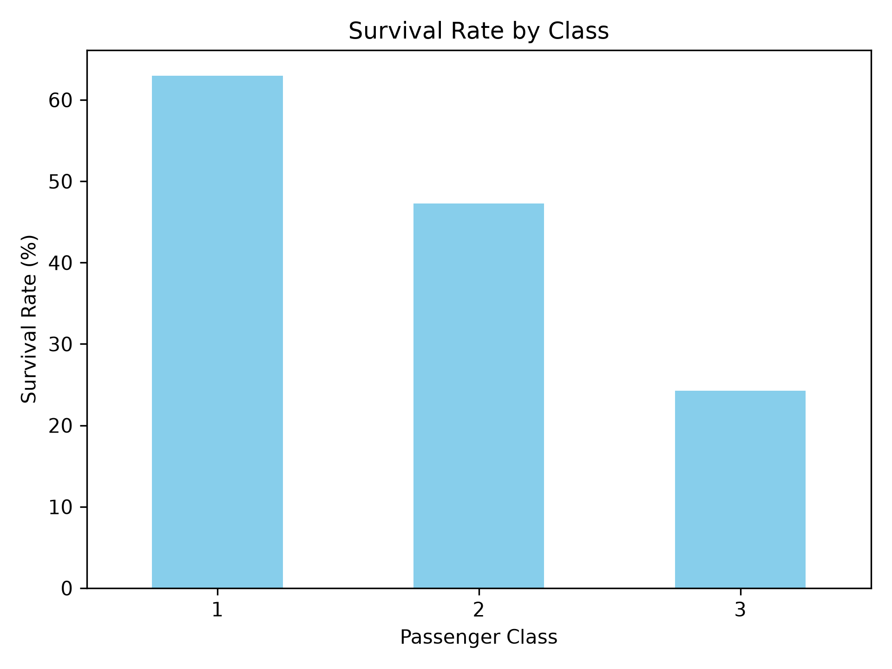
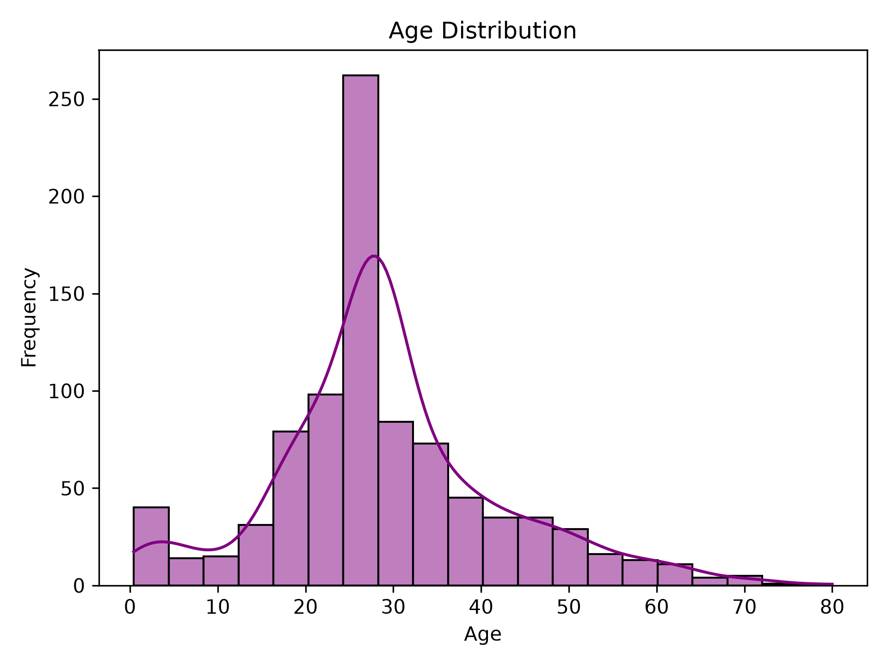
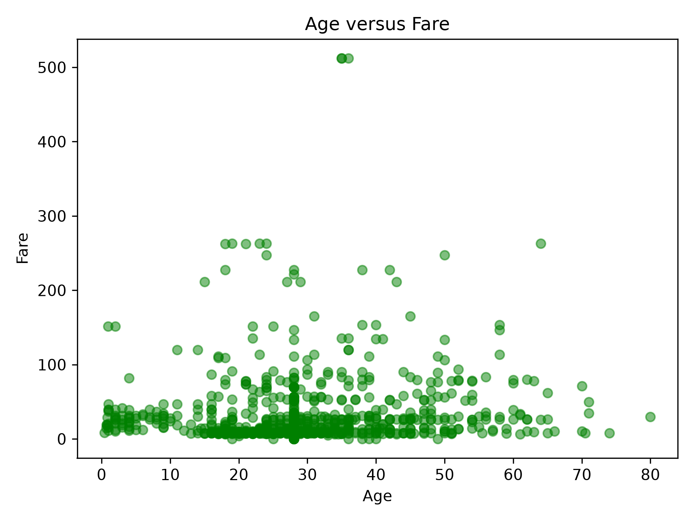

# Titanic EDA

A small project I made to practice using pandas, Matplotlib, and Seaborn.

I used the [Titanic dataset]([https://raw.githubusercontent.com/datasciencedojo/datasets/master/titanic.csv](https://raw.githubusercontent.com/datasciencedojo/datasets/master/titanic.csv)) to clean the data, explore survival rates, and create graphs.

## What I Did

- Loaded and inspected the Titanic dataset.

- Checked summary statistics.

- Filled missing ages with the median age.

- Filled missing embarkation ports with the most common value.

- Replaced missing cabin values with `Unknown`.

- Removed duplicate rows.

- Filtered first-class passengers.

- Calculated survival rates by passenger class.

- Created three visualizations.

- Saved the cleaned dataset as `titanic_cleaned.csv`.

## Visualizations

### Survival Rate by Class



### Age Distribution



### Age vs. Fare



## Tools Used

- Python

- pandas

- Matplotlib

- Seaborn

## How to Run

Install the required libraries:

```bash

python3 -m pip install pandas matplotlib seaborn

```

Run the script:

```bash

python3 titanic_[eda.py](http://eda.py)

```

The script generates three graph images and saves the cleaned dataset as `titanic_cleaned.csv`.


